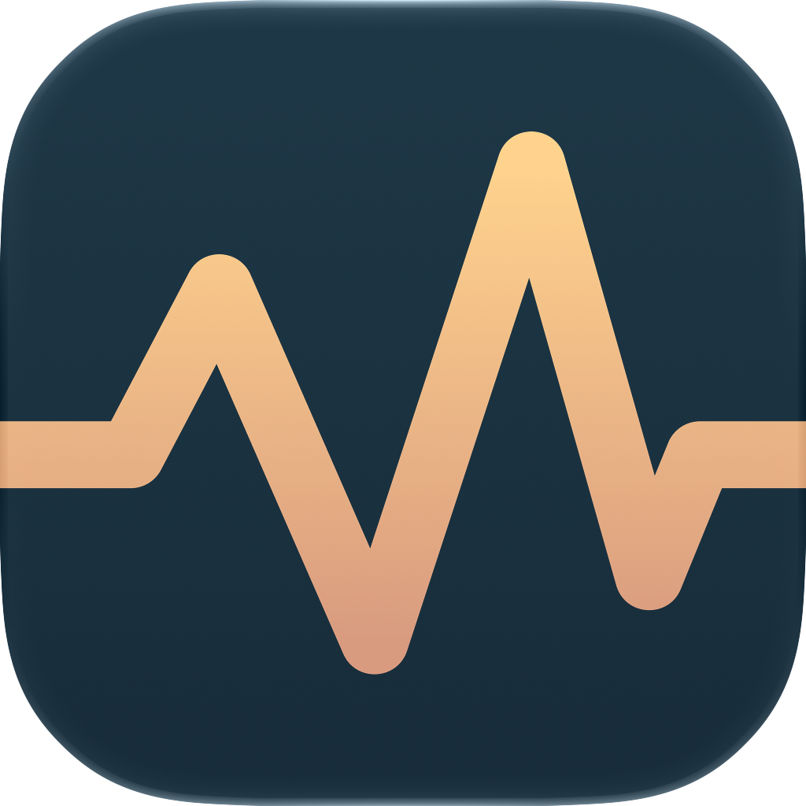

<div align="center">



# Mactivity ⚡

**A lightweight, native macOS & Apple Silicon system telemetry monitor.**  
*Engineered with Swift 6 & SwiftUI · Direct Mach Kernel Telemetry · Zero Mock Data · Architectural Bento Grid*

<p align="center">
  <a href="https://github.com/rifqi-rahman/Mactivity/releases"></a>
  <a href="https://rifqi-rahman.github.io/Mactivity/"></a>
  <a href="#-getting-started"></a>
  <a href="#-universal-mac-hardware-intelligence"></a>
  <a href="#-tech-stack--performance"></a>
  <a href="LICENSE"></a>
</p>

<p align="center">
  <a href="#-overview">Overview</a> •
  <a href="#-key-features">Key Features</a> •
  <a href="#-universal-mac-hardware-intelligence">Hardware Intelligence</a> •
  <a href="#-interactive-bento-customization">Customization</a> •
  <a href="#-palette--design-system">Design System</a> •
  <a href="#-getting-started">Getting Started</a>
</p>

---

</div>

## 📖 Overview

**Mactivity** is a modern, high-precision system activity monitor built exclusively for macOS. It lives unobtrusively in your menu bar with a rock-solid, jitter-free status pill, and expands into a floating glassmorphic **Bento Dashboard** with a single click.

Unlike conventional monitoring utilities that spawn resource-heavy background shell commands (`top`, `pmset`, `netstat`), Mactivity communicates directly with the **Mach Kernel (`host_statistics64`, `vm_statistics64`)**, **IOKit registry**, and **Darwin `libproc` subsystems**. The result is immediate, sub-second telemetry with virtually zero overhead (**~20 MB RAM** and **<0.3% CPU**).

Whether you are running a fanless **MacBook Air**, a high-core-count **MacBook Pro**, a compact **Mac mini**, or a **Mac Studio / Mac Pro workstation**, Mactivity dynamically adapts to your exact hardware without a single line of mock data.

---

## 🌟 Key Features

### 🍱 1. Interactive Drag-and-Drop Bento Dashboard
* **Dynamic Grid Layout**: Live telemetry organized into a harmonious 2-column Bento grid with frosted glass cards, subtle hover glows, and responsive unit readouts.
* **Rearrange On-the-Fly**: Enter **Bento Edit Mode** (`Right-Click > Customize Bento Layout...`) to rearrange metric cards via intuitive drag-and-drop.
* **Deep-Dive Routing**: Clicking any card immediately launches the dedicated **Inspector App** focused on that specific hardware component.

### 🎛️ 2. Zero-Jitter Menu Bar Pill with 9 Metric Modes
* **Pixel-Stabilized Footprint**: Configured with fixed-width geometry per mode so metric number fluctuations never cause adjacent menu bar icons to shift or jitter.
* **9 Flexible Display Modes**:
  1. `CPU & Network` (`⊚ 14%  ↓24K`)
  2. `CPU Only` (`􀧓 14%`)
  3. `CPU & Memory` (`􀫥 14% · 42%`)
  4. `Memory Only` (`􀫥 42% RAM`)
  5. `Battery Status` (`􀛩 88%⚡`)
  6. `Network Bandwidth` (`􀤆 ↓1.2M ↑180K`)
  7. `SoC Thermals` (`􀇬 44°C`)
  8. `Compact All-in-One` (`C:14% M:42% ↓24K`)
  9. `Minimal Icon Only` (`􀧗`)

### 🪟 3. Auxiliary Fullscreen Float & Effortless Dismiss
* **Fullscreen Apps Overlay**: Configured with macOS Window Server auxiliary behaviors (`.canJoinAllSpaces` & `.fullScreenAuxiliary`). Mactivity floats directly on top of native macOS Fullscreen applications (Xcode, Safari, Terminal, IDEs) without triggering distracting space transitions.
* **Natural Dismissal**: Automatically closes when you click anywhere outside the popup, re-click the menu bar status icon, or press the `ESC` key.

### 🖥️ 4. Dual-Mode Architecture: Menu Bar + Full Inspector App
* **Menu Bar Accessory Mode**: Minimalist background operation with zero Dock icon clutter (`NSApp.ActivationPolicy.accessory`).
* **Dedicated Inspector App**: Promotes to a full macOS window (`NSApp.ActivationPolicy.regular`) with full-width clickable sidebar tabs:
  * **Dashboard**: Panoramic helicopter overview of all hardware subsystems.
  * **Processor (CPU)**: Per-core cluster load bars (P-Cores vs. E-Cores) & dual-tone historical timelines.
  * **Unified Memory (RAM)**: Multi-segment donut chart tracking App, Wired, Compressed, and Cached memory pressure.
  * **Metal GPU**: Hardware acceleration utilization & shared unified VRAM allocations.
  * **Network**: Symmetrical mirrored download/upload traffic waves and cumulative data counters.
  * **Storage & Volumes**: Real-time read/write throughput and container partitions.
  * **Thermals & Fans**: Live die temperatures and tachometer blower curves.
  * **Process Manager**: Real-time process explorer with memory/CPU sorting and instant termination.

---

## 🧠 Universal Mac Hardware Intelligence

> [!IMPORTANT]
> **Zero Mock Data Commitment**: Every core cluster, memory page, peripheral battery percentage, fan tachometer, and thermal reading reflects 100% genuine macOS kernel and IOKit telemetry.

Mactivity inspects your Mac's hardware tree at launch and configures its monitoring pipelines accordingly:

| Hardware Domain | MacBook Pro | MacBook Air | Desktop Macs (Mac mini / Studio / Pro) | Intel Macs |
| :--- | :--- | :--- | :--- | :--- |
| **Model & Chip** | Dynamic (`MacBook Pro · Apple Silicon`) | Dynamic (`MacBook Air · Apple Silicon`) | Dynamic (`Mac mini / Studio / Pro · M-series`) | Dynamic (`iMac / Mac Pro · Intel Core/Xeon`) |
| **CPU Cluster Topology** | Real `P` + `E` Cores (e.g. 10P + 4E) | Real `P` + `E` Cores (e.g. 4P + 4E) | High-core workload topology | Symmetrical `C1..Cn` Cores |
| **Metal GPU** | Direct Metal pipeline query | Direct Metal pipeline query | Metal unified pipeline query | Metal / Discrete GPU probe |
| **Thermal & Blowers** | Dual Centrifugal Fans (Left & Right RPM) | **Fanless Passive Cooling** (0 dB, 0 RPM) | Single or Multi-Fan Blowers | Desktop thermal management |
| **Power Architecture** | Battery Health %, Cycles, Charging State | Battery Health %, Cycles, Charging State | **Desktop AC Mode**: Direct Mains Power Rail | AC / Battery / UPS detection |
| **Bluetooth Peripherals** | Genuine peripheral battery (Magic Mouse, Keyboard, AirPods, MX Master) | Genuine peripheral battery | Genuine peripheral battery | Genuine peripheral battery |

---

## 🎨 Palette & Design System

Mactivity is styled with a bespoke **Nordic Architectural Palette**, delivering a calm, focused, and distraction-free aesthetic that complements macOS Sonoma, Sequoia, and Dark Mode:

<div align="center">

| Color Token | Hex Code | Visual Swatch | Primary Role |
| :--- | :---: | :---: | :--- |
| **Midnight Petrol Teal** | `#0F3040` | `■` | Deep matte canvas background & frosted card glass |
| **Muted Slate Gray** | `#464858` | `■` | Structural borders, card dividers, inactive track bars |
| **Muted Terracotta Rose** | `#A56F63` | `■` | System load, upload bandwidth, remote volumes, secondary gauges |
| **Warm Sand Peach** | `#D99B7F` | `■` | User load, download bandwidth, active highlights, primary gauges |

</div>

---

## 📊 Telemetry Modules Matrix

```
┌────────────────────────────────────────────────────────────────────────┐
│                        MACTIVITY TELEMETRY PIPELINE                    │
├───────────────────┬────────────────────────────────────────────────────┤
│ Processor (CPU)   │ Mach host_processor_info() · P/E Core Topologies   │
│ Memory (RAM)      │ mach_vm_statistics64() · Pages & Memory Pressure   │
│ Graphics (GPU)    │ Metal Device API · sppci_cores & Unified VRAM      │
│ Network Speed     │ Darwin getifaddrs() · Mirrored Symmetrical Waves   │
│ Network Ledger    │ Persistent Byte Ledger · Today / 7-Day / 30-Day    │
│ Thermals & Fans   │ IOHIDEventSystem & AppleSMC · Die Temperatures     │
│ Power & Battery   │ IOPMPowerSource & IOPlatformExpert · Cycles/Health │
│ Peripherals       │ IOBluetoothDeviceInfo · Genuine Battery Indicators │
│ Top Processes     │ libproc proc_pidinfo() & task_threads()            │
│ Storage Volumes   │ FileManager & statvfs() · Read/Write Throughput    │
└───────────────────┴────────────────────────────────────────────────────┘
```

---

## 🚀 Getting Started & Installation

### Option A: Direct Download (Recommended for General Users)

If you want to download and run Mactivity immediately without using Terminal or installing Xcode tools:

1. **Download the latest release**:
   * [**Download Mactivity.dmg**](https://github.com/rifqi-rahman/Mactivity/releases/latest/download/Mactivity.dmg) — Official macOS Disk Image with `/Applications` drag-and-drop installer (~4.4 MB).
   * [**Download Mactivity.zip**](https://github.com/rifqi-rahman/Mactivity/releases/latest/download/Mactivity.zip) — Standalone compressed application archive (~4.0 MB).
   * Or view all release tags and SHA-256 checksums on [GitHub Releases](https://github.com/rifqi-rahman/Mactivity/releases).
2. **Install to Applications**:
   * Double-click `Mactivity.dmg` and drag the **Mactivity** icon into your **Applications** shortcut.
3. **Launch Mactivity**:
   * Open Mactivity from Spotlight (`⌘ + Space`) or Launchpad. The live status pill will instantly appear in your menu bar.

> [!TIP]
> **First-Time Launch (macOS Gatekeeper)**:  
> Because Mactivity is a free, independent open-source project and is not signed with an annual $99 Apple Developer subscription, macOS may display an *"Unidentified Developer"* alert on the first launch.  
> **How to open:** Simply **Right-Click (or Control + Click) `Mactivity.app` in `/Applications` > select "Open" > click "Open"** in the confirmation dialog. You only need to do this once.

---

### Option B: Build from Source (For Developers)

#### Prerequisites
* macOS 14.0 (Sonoma) or macOS 15.0+ (Sequoia)
* Apple Silicon (M1, M2, M3, M4) or Intel 64-bit Mac
* Xcode 15+ Command Line Tools (`xcode-select --install`)

#### 1. Clone the Repository
```bash
git clone https://github.com/rifqi-rahman/Mactivity.git
cd Mactivity
```

#### 2. Build the Native App Bundle
Run the automated build script:
```bash
chmod +x build.sh
./build.sh
```
*(To build and package into `.dmg` and `.zip`, run `./build.sh --package` or `./scripts/package-release.sh`)*

#### 3. Launch Mactivity
```bash
open build/Mactivity.app
```
*The Mactivity icon will immediately appear in your menu bar.*

#### 4. Configure Launch at Login (Recommended)
To keep Mactivity active across system restarts:
1. Open **System Settings** > **General** > **Login Items**.
2. Under **Open at Login**, click the **`+`** button.
3. Select `Mactivity.app` from `/Applications` (or your repository's `build/` folder).

---

## ⌨️ Controls & Gestures

| Action | Gesture / Shortcut | Description |
| :--- | :--- | :--- |
| **Toggle Bento Dashboard** | **Left-Click** menu bar icon | Opens or closes the floating Bento dashboard popover |
| **Quick Actions Menu** | **Right-Click** menu bar icon | Access Metric Display modes, Inspector Window, Activity Monitor, and Quit |
| **Customize Layout** | **Right-Click > Customize Bento Layout...** | Drag-and-drop to reorder Bento cards in real-time |
| **Dismiss Popup** | **Click Outside** or press `ESC` | Instantly dismisses the popover from any screen or fullscreen space |
| **Open Inspector Window** | Click **"Open App"** in popover | Launches the full multi-tab Mac App with sidebar navigation |
| **Inspect Component** | Click any Bento card | Directly routes the Inspector window to that specific module |

---

## 📂 Project Architecture

```
Mactivity/
├── assets/
│   └── icon.png                       # High-res 1024x1024 application icon
├── Mactivity.icon/                    # macOS App Icon asset catalog
├── Resources/
│   ├── AppIcon.icns                   # Multi-resolution macOS icon asset
│   └── Info.plist                     # Bundle metadata (LSUIElement = true)
├── Sources/
│   └── MacUsage/
│       ├── Main.swift                 # Application lifecycle & NSApplicationDelegate
│       ├── MenuBarController.swift    # Status item, event monitors, and popover controller
│       ├── Models/
│       │   ├── SystemMetrics.swift    # Kernel telemetry models & universal hardware probes
│       │   └── UIState.swift          # Observable state, bento layout order, metric modes
│       ├── Services/
│       │   ├── MetricsCollector.swift # Direct Mach, IOKit, sysctl & libproc sampler
│       │   └── WindowManager.swift    # Dual-mode window promotion & activation controller
│       └── Views/
│           ├── DashboardView.swift    # 2-column Bento dashboard popover & drag-drop reordering
│           ├── Cards/
│           │   └── CardViews.swift    # Modular telemetry cards with hover states & routing
│           ├── Components/
│           │   └── VisualComponents.swift # Donut charts, radial ticks, fluid thermometers
│           └── Inspector/
│               └── InspectorWindowView.swift # Full-width clickable sidebar & detail panels
├── build.sh                           # Clean, automated compilation & bundle script
├── PRD.md                             # Technical design requirements & specifications
├── README.md                          # Repository documentation & hardware guide
└── LICENSE                            # MIT Open Source License
```

---

## ⚡ Performance & Privacy

* **Zero Shell Execution**: No sub-processes or shell scripts spawned. No `/bin/sh -c` latency.
* **100% Sandboxed & Local**: Operates completely offline with zero telemetry, zero analytics, and zero external network calls.
* **Minimal Energy Impact**: Background timer throttles dynamically and respects macOS App Nap and Low Power modes.

---

## 🤝 Contributing

Contributions, issues, and feature requests are welcome!  
Feel free to check out the [issues page](https://github.com/rifqi-rahman/Mactivity/issues) if you want to contribute or submit a pull request.

1. Fork the Project
2. Create your Feature Branch (`git checkout -b feature/AmazingFeature`)
3. Commit your Changes (`git commit -m 'feat: add amazing feature'`)
4. Push to the Branch (`git push origin feature/AmazingFeature`)
5. Open a Pull Request

---

## 📄 License

Distributed under the **MIT License**. See [`LICENSE`](LICENSE) for more information.

---

<div align="center">
  <sub>Crafted with passion for macOS and Apple Silicon by <a href="https://github.com/rifqi-rahman">Rifqi Rahman</a>.</sub>
</div>
